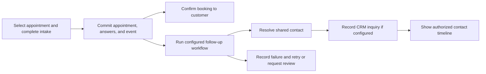

# Suite architecture

This document defines the accepted architecture and labels recommendations that still require validation. It describes the target behavior; [scaffold evidence](scaffold-status.md) distinguishes the initial implementation from remaining work. Product scope lives in [intent.md](../intent.md), terms in [CONTEXT.md](../CONTEXT.md), rationale in [decisions.md](decisions.md), and implementation gates in [build-plan.md](build-plan.md).

The suite is a modular monolith with selectable applications, shared business identities, and built-in workflows. One installation packages the business backend, frontend runtime, database, authentication, and operational support. Applications remain independently useful while optional connections compose them into a business system.

## Confirmed decisions

| Area | Decision |
| --- | --- |
| Product model | Open-source applications for SMEs under AGPL-3.0, usable independently and together. Commercial resale and hosting are permitted with license compliance; branding is governed by a separate trademark policy. See [ADR 0006](adr/0006-agpl-and-trademark-policy.md). |
| Hosting priority | Easy self-hosting on Apple Silicon. |
| Business backend | Rust with Axum and SQLx. |
| Database | PostgreSQL. SQLite is not the planned database. |
| Default authentication | Required Supabase Auth dependency, self-hosted through pinned upstream Docker images and the standard Supabase-managed `auth` schema. Do not implement a separate custom password/session system. |
| Hosted option | A separate hosted Supabase instance, including Auth, through the same application integration. Each installation uses one active instance; local and hosted instances do not synchronize. |
| Frontend language | TypeScript, with an SSR-capable framework. |
| Frontend framework | Svelte with SvelteKit and TypeScript; SSR is selected. |
| Authorization | Application-level RBAC plus workspace and resource checks in Rust. |
| Database exposure | Backend-only application data access. Do not provide a public path that bypasses application authorization. |
| RLS | Do not duplicate application business permissions in RLS under the agreed access model. |
| Architecture | Modular monolith with explicit module interfaces, application services, focused data access, and durable background work. |
| Packaging | One standard distribution with workspace-enabled applications, delivered as a Docker Compose bundle to be tested on Apple Silicon. |
| Shared business identities | A lightweight Contacts module owns contacts and organizations independently of CRM and login identities. |
| Composition | Built-in recipes connect module operations through durable workflows. A general visual automation builder is deferred. |
| Disabled applications | Block application access and workflows while retaining records. Data deletion is separate. |
| Operational logs | Local ClickHouse; asynchronous collection must not be a prerequisite for business writes. Authoritative business audit records remain in PostgreSQL. |
| Engineering priorities | Small operational footprint, strong performance, reliability, extensibility, and maintainability. |

The Rust requirement applies to our business backend. Supabase Auth is an existing service written in Go; reusing it is intentional.

## Deployment and installation

### Default self-hosted mode

- TypeScript frontend and its SSR runtime.
- Rust application backend.
- PostgreSQL.
- Self-hosted Supabase Auth.
- Local ClickHouse for operational logs, with persistent storage and a validated collection pipeline.
- Required routing, secrets, persistent volumes, and service health configuration.
- Configurable SMTP delivery for invitations, account recovery, and magic-link login.
- Cloudflare Tunnel for configured public HTTPS hostnames routed to local service ports.

Supabase's self-hosted distribution is a collection of Docker services managed with Compose, not one all-in-one Supabase image. Use pinned upstream images and the official configuration as the starting point, retain the standard Supabase-managed `auth` schema, and validate any removal of unused services and dependencies. The initial Auth-only subset is described in [scaffold evidence](scaffold-status.md); full login behavior, upgrades, and resource baselines remain validation gates. See the [official Docker deployment guide](https://supabase.com/docs/guides/self-hosting/docker).

Docker and Compose are accepted local deployment dependencies. The user accepts container runtime overhead; measure it as part of whole-stack performance rather than making a native rewrite a prerequisite. A custom native Supabase distribution, the experimental native CLI runtime, and Apple Container orchestration are not phase 0 or phase 1 targets. Select and document a tested Docker environment on Apple Silicon during installation validation; this decision does not require a particular commercial desktop runtime or the entire Supabase service catalog.

### Migration and installation configuration

Suite-owned PostgreSQL migrations live in `supabase/migrations/` and are created/applied through the pinned Supabase CLI against an explicitly selected database. SQLx owns runtime queries/transactions, not a second migration history. Preserve upstream ownership of Supabase bootstrap and `auth` migrations. ClickHouse schema setup is separate. The default installation namespace is the Compose project `looski-suite`; retain pinned upstream image references and avoid fixed global container/volume names.

The [setup contract](setup-contract.md) owns detailed configuration, migration targeting, naming, dependency readiness, proposed internal ports, and public routing. Its default topology exposes one configurable loopback gateway port (`58888` selected); the remaining services use private Compose DNS addresses. Internal port values, gateway implementation, collision handling, and generated-configuration tooling still require phase 0 validation.

### Public access through Cloudflare Tunnel

Use stable HTTPS hostnames routed through Cloudflare Tunnel to the configured frontend/API and required Auth endpoints. A single public application origin with internal routing is the proposed starting point; see the [setup contract](setup-contract.md#cloudflare-tunnel-routing) for the concrete gateway topology and remaining validation. If the connector runs in Compose, route to service names on its network rather than assuming its `localhost` is the host. Keep database ports and administrative interfaces private.

Configure the application origin, Supabase external URL, Site URL, and allowed authentication redirects together. A tunnel supplies reachability; it does not deliver email or keep a sleeping Mac available. Test browser redirects and secure SSR sessions through the real public hostname.

### Optional hosted Supabase mode

The frontend integrates with the selected instance's Auth service; Rust validates its identities and connects to that instance's PostgreSQL database. The frontend does not connect directly to application database tables. The application's workspace membership and permission model remains the same. Provider URLs, keys, database connections, callback URLs, and deployment configuration change; application workflows should remain consistent.

Local and hosted Supabase are independent instances, with independent databases, Auth identities, sessions, keys, and configuration. An application installation selects one instance at a time. There is no automatic replication, shared login session, dual write, or fallback to the other instance. Starting a fresh installation against a hosted instance does not require importing a local installation.

Moving an existing installation to hosted Supabase is an explicit migration and cutover. Transfer supported application and Auth data, preserve or deliberately map identities, update issuer-to-user mappings, migrate files if their storage changes, and configure the destination's keys, mail, providers, and callback URLs. Preserve application user IDs, workspace memberships, and business relationships. Plan for users to sign in again; session continuity is not a requirement.

Using the standard Auth schema reduces custom migration work but does not establish version compatibility or make migration a configuration-only operation. Validate the supported source/destination versions and transfer procedure, including password login and any enabled identity providers, before claiming migration support. Stop writes to the source for the initial cutover procedure; live replication and zero-downtime migration are outside the initial scope. Supabase's [backup and restore guidance](https://supabase.com/docs/guides/platform/migrating-within-supabase/backup-restore) is a reference, not evidence that our local-to-hosted migration has passed validation.

### Installation contract

The installer should make deployment deterministic enough for a local agent to operate reliably:

- Use pinned, prebuilt releases and compatible container images under the resolved `looski-suite` installation namespace.
- Resolve one installation configuration and derive service URLs, Auth callbacks, and tunnel routes consistently; check health and successful Supabase CLI migrations before releasing the API/worker.
- Validate prerequisites, available ports, and configuration.
- Generate unique secrets and initialize persistent storage.
- Bootstrap the first administrator without leaving open registration or setup access.
- Configure authentication URLs, callbacks, and the application address.
- Start selected modules and verify service health.
- Provide understandable status, update, backup, and restore commands.

Apple Silicon image compatibility and whole-stack resource consumption must be verified. Docker on macOS also has runtime overhead, which belongs in footprint measurements.

Local access, private team access, and public internet access are separate deployment modes. Invited users must be able to reach the application through the network, a VPN, or a public HTTPS endpoint. An always-on host is required for dependable team access and public CMS serving; hosted authentication alone does not make a local application reachable.

## Authentication, invitations, and permissions

### One authentication implementation, two hosting modes

Use Supabase Auth in both self-hosted and hosted deployments. Each installation has a configured Auth service; users do not choose between competing login systems at sign-in.

Supabase owns its standard `auth` schema, including authentication users, identities, credentials, and sessions, and its own schema migrations. Use supported Auth interfaces for routine account operations. Do not add suite-specific columns, tables, or business rules to that schema or maintain a fork of its migrations. Supabase-managed database objects can change between versions; see [user management guidance](https://supabase.com/docs/guides/auth/managing-user-data).

Application users, provider identity mappings, workspace memberships, invitations, roles, and business records live in application-owned tables outside `auth`. These records support business access and stable references; they are not a second password or session system. The exact application schema names remain an implementation choice.

| Responsibility | Owner |
| --- | --- |
| Password verification, authentication sessions, account recovery | Supabase Auth |
| Login and account-setup screens | Our frontend, integrated with Supabase Auth |
| Workspace invitations and invitation lifecycle | Our application |
| Workspace membership, roles, and permissions | Our Rust backend and application tables |
| Authorization of every business operation | Our Rust application services |
| Self-hosted deployment, upgrades, and recovery | Our distribution and the installation operator |

Supabase establishes identity. It does not decide whether an identity belongs to a workspace or may edit its records. End users do not need Supabase dashboard accounts.

Accepted future customer access uses separate workspace-scoped external memberships, external role assignments, and module-owned typed record/action grants. Each operation requires both the external role permission and the explicit record/action grant, using current membership and revocation state. Enforce staff/external role audiences and external-eligible permissions; never union staff and external access implicitly. Contact-to-user links establish representation only and grant no access. Shared-data views exclude internal content and do not open linked records. See the [external access design](crm-plan.md#accepted-external-access-relationship); these relations are not implemented yet.

### Login methods

Support email/password and Supabase magic-link login through the same identity mapping. Configure SMTP and allowlisted callback URLs. The SvelteKit server callback verifies the link through Supabase and establishes the session using its SSR integration; validate this flow rather than inventing a separate token system. Ordinary login must not create arbitrary accounts implicitly (`shouldCreateUser: false` for magic-link sign-in); bootstrap and application-owned invitations control onboarding. Authentication never grants workspace membership on its own.

Test expired and reused links, invitation acceptance, session refresh, and callback behavior through Cloudflare Tunnel in both local and hosted modes.

### Teammate invitation flow

Inviting users is a core requirement in both deployment modes.

1. An authorized member enters an invitee's email, workspace, and proposed role.
2. Rust verifies that the inviter may invite members and grant that role.
3. The application creates a pending, expiring invitation with a secure token.
4. A new identity completes Supabase account setup; an existing identity signs in. The exact callback and email flow will be designed during implementation.
5. Rust verifies the authenticated identity and its match to the intended invitation recipient.
6. The application atomically accepts the invitation and creates the workspace membership and role assignments.
7. Subsequent requests are authorized against current application membership and permissions.

Invitations must support expiration, revocation, and safe retries. Creating an Auth identity alone grants no workspace access. Removing a membership must remove workspace access even while a login session remains valid.

Email delivery must be configured for emailed invitations and recovery. Copyable invitation links may be offered when automated email is unavailable; link acceptance still requires the appropriate identity checks. SMTP/provider choice and the exact account-recovery experience remain open.

### External developers and delegated API access

Design now for external developers to obtain user-authorized OAuth access and call the Rust HTTP API directly with `Authorization: Bearer <access_token>` in a future release. Shipping an OAuth server, client registration, and consent UI is deferred beyond phases 0 and 1; those features are not prerequisites for the first CRM release. Browser cookie transport is a separate frontend integration choice; it must not make the API dependent on SvelteKit sessions. This requirement does not enable direct database access or runtime plugins.

Supabase Auth's OAuth server is the initial integration candidate: authorization code with PKCE, refresh tokens, registered clients and redirect URIs, and a suite-owned login/consent screen. As of the documentation review on October 4, 2026, the feature is marked beta, supports standard OIDC scopes but not custom scopes, and does not support the client-credentials grant. Validate the pinned self-hosted Auth image, configuration, asymmetric signing, discovery, and public endpoints through Cloudflare Tunnel before claiming local support. Local and hosted installations retain their own issuers and client registrations; no central shared authorization server is implied.

Rust must distinguish delegated OAuth tokens using verified client identity and restrict access to an active application-owned grant for the user, client, and selected workspace. Effective access is the intersection of the grant's allowed actions, the user's current permissions, and enabled applications. Standard OIDC scopes do not grant CRM permissions. Deny OAuth requests without an applicable grant; never treat a third-party token as unrestricted first-party access merely because it is a valid user JWT. Use access tokens for API access, not OIDC ID tokens, and keep the Supabase Data API inaccessible as already required.

When implementing external OAuth, build explicit consent, connected-application management, revocation, and audit records. Resolve binding a consent grant to the authorization/session, refresh behavior, reauthorization after revocation, and permission escalation before implementation. A revoked grant must stop API access even if a JWT has not expired. Client registration policy, developer documentation, rate limits, and the exact permission vocabulary remain open. User-approved background access through refresh tokens is distinct from service-account access with no human authorization; the latter needs a separate design.

References: [OAuth server setup and beta status](https://supabase.com/docs/guides/auth/oauth-server/getting-started), [supported flows and scope limitations](https://supabase.com/docs/guides/auth/oauth-server/oauth-flows), and [OAuth token claims](https://supabase.com/docs/guides/auth/oauth-server/token-security).

### Application identity model

Keep stable application user IDs and an explicit mapping to authentication identities. Suggested records are:

| Record | Purpose |
| --- | --- |
| `users` | Stable application identity. |
| `auth_identities` | Mapping from provider issuer and subject to an application user. |
| `workspaces` | Business or collaboration boundary. |
| `memberships` | Active relationship between a user and a workspace. |
| Roles and permission assignments | Actions and scopes granted to a membership. |
| `invitations` | Pending and completed invitation lifecycle. |

Avoid coupling every business table directly to provider-owned auth tables. Validate provider tokens with maintained libraries and explicit issuer, audience, expiry, and signing-key checks. Session refresh, logout, suspension, and callback behavior require integration tests.

Contacts are not authentication profiles. Do not create an Auth user for every contact or join contacts to users by email/phone. Support an explicit contact-to-login onboarding path with an invitation bound to the selected contact and intended access. User/contact links are application-owned data with workspace and purpose checks; shared correspondence addresses do not imply shared identity or access. Contact merges and email changes must not mutate credentials or membership implicitly. See the [CRM plan](crm-plan.md#contacts-and-authenticated-users).

### Application authorization

Use action-based permissions such as `contacts.read`, `contacts.export`, `cms.articles.edit`, `cms.articles.publish`, and `workspace.members.manage`. Roles are collections of permissions rather than hard-coded role-name checks scattered through the code.

Every operation receives a verified actor and workspace context. Permissions establish which action is allowed; explicit record scope on each role-permission grant and workspace/resource rules establish which records the action may affect. Reuse the existing role/permission/assignment tables; combine allowed scopes only for the same action. No implicit grants from membership, role names, or template installation. Permanent deletion is a distinct permission from archive/update. Unsupported scope modes deny access until implemented and tested.

The suite owns the permission vocabulary, role assignments, resource policies, and future delegated API grants in application tables. Supabase supplies verified identity and session credentials; its generic authenticated role or identity scopes do not confer suite permissions. A permission describes an action a member may perform. A delegated API scope limits which actions an integration may perform on that member's behalf; it can only narrow access. Scope names may reuse the permission vocabulary or map to explicit bundles, with the mapping owned by the suite rather than the identity provider.

Keep token/cookie validation in transport adapters and pass a typed, verified authorization context into application services. The design must distinguish first-party sessions from delegated clients and allow future client/grant restrictions without rewriting business operations. Client identity and grant references must come from verified credentials and server-side state, never a caller-supplied trust flag. Until delegated access is implemented, reject third-party OAuth credentials rather than applying first-party permissions to them. No OAuth grant tables or consent screens are required just to preserve this interface boundary.

Enforce these checks in application services used by HTTP routes, jobs, imports, integrations, and CLI commands. Ordinary repositories require workspace scope. Administrative cross-workspace operations are explicit exceptions.

The database should be reachable only through approved backend/administrative paths. Local deployment should use loopback, Unix sockets, or private container networking. Runtime and migration database roles should have separate privileges.

For hosted Supabase, disable application Data API access and configure database/pooler network restrictions. These are separate controls. Any future direct access through Storage, Realtime, or other services requires a separate authorization design; Rust checks do not automatically protect those paths.

A private database does not prevent an application query from returning the wrong workspace's records. Authorization and scoped-query tests are required, especially because application RLS is not the chosen additional guardrail.

## Frontend direction

Svelte with SvelteKit, TypeScript, and SSR is selected. The choice provides one frontend framework for routing, server rendering, and interactive business screens. It is an accepted product and engineering choice, not a measured performance claim against other frameworks.

Validate the selected framework through a representative CRM table, session integration, and an editor interaction; those probes select supporting libraries and establish correctness rather than reopening the framework choice. The initial state model is:

| Kind of state | Default owner |
| --- | --- |
| Dialogs, selections, unsaved inputs | Local reactive state. |
| Computed totals and derived selections | Derived state. |
| State shared within a component tree | Context containing reactive state. |
| Search, sort, and pagination | URL parameters where appropriate. |
| Durable business records | Backend, surfaced through page loading or a deliberate client cache. |

An additional global state library is not required by default. Add a library when it provides needed capabilities such as query caching, optimistic updates, state machines, undo/redo, or offline synchronization. Keep authenticated SSR state scoped to each request.

Keep frontend server responsibilities focused on rendering, session integration, and calling Rust. Rust remains authoritative for business rules and authorization. Generate TypeScript API clients from a maintained contract instead of duplicating backend models manually.

The selected contract pipeline is Rust request/response types and Axum route metadata to OpenAPI using `utoipa` with `utoipa-axum`, then a generated TypeScript client. The TypeScript generator and pinned dependency versions remain open implementation choices. Validate documented errors and security requirements as well as success responses. This HTTP contract does not replace internal Rust module interfaces or runtime authorization.

Styling, component library, query-cache library, and editor/grid implementations are not finalized. A JavaScript SSR process alongside Rust is an accepted consequence of this direction, not a single-native-binary deployment.

## Backend architecture and composition

Use a modular monolith initially: one application deployment with well-defined modules. Users select the applications they need without operating a separate distributed system for each one.

The mandatory foundation includes identities, workspaces, memberships, permissions, lightweight Contacts, files, jobs, audit history, installation, updates, and recovery. Build these capabilities incrementally through real journeys. A foundation capability is not a license to create a broad general-purpose platform before the first application works.

Each module owns its business rules, tables, migration contents, permissions, and interface. Suite PostgreSQL migration files share the canonical `supabase/migrations/` directory and Supabase CLI history. Integrations invoke business operations through that interface rather than reading or writing another module's tables directly. Authorized read interfaces provide linked previews and timeline entries; specialized cross-module reporting requires an explicit design rather than ad hoc joins that bypass ownership or access checks.

Start with runtime-enabled applications in one standard distribution. Selection is per workspace; code and migrations may be present even when an application is disabled. Runtime third-party plugins and selected build bundles that physically omit application code are deferred. Use versioned external APIs/webhooks where needed; internal module calls do not require HTTP between modules.

### CLI, HTTP API, and MCP interfaces

The suite must expose supported business capabilities through a CLI, an HTTP API, and MCP, alongside the SvelteKit UI. This is an accepted product requirement. Each capability should declare its supported commands, endpoints, and tools; document any deliberate omission. Infrastructure recovery commands are a separate operational surface and must not automatically become business API endpoints or agent tools.

All transports converge on the owning module's Rust application operations. Adapters translate inputs, establish verified actor/workspace context, and translate results; they do not implement independent permission rules, matching rules, or business transitions. Jobs call the same operations under explicit execution authority. Application services never infer administrator access from a local process, CLI invocation, or MCP connection.

Proposed initial deployment:

- Axum exposes the canonical HTTP API with OpenAPI contracts. SvelteKit calls it for business operations.
- The CLI acts as an authenticated HTTP client of a selected installation. It never opens the business database directly. Provide explicit installation/workspace selection, machine-readable JSON output, stable exit statuses, and diagnostics on stderr.
- A locally launched MCP stdio adapter calls the same HTTP API using an operator-configured first-party credential. Credential acquisition, refresh, secure storage, and supported MCP SDK/version need a phase 0 probe. Do not supply a Supabase service-role key or database credentials to the CLI or MCP client. This initial adapter runs with the configured user's permissions; it is not a substitute for future per-integration consent/grants.
- Remote Streamable HTTP MCP is a future transport target alongside delegated OAuth. Its authentication must validate tokens for the intended MCP resource and enforce grants; do not blindly forward arbitrary incoming bearer tokens to another resource. A future in-process MCP adapter can invoke Rust application operations using verified context. Do not expose an unauthenticated remote MCP endpoint to avoid implementing authorization.

MCP tools should describe business tasks such as finding a contact or moving a deal to a stage, with typed inputs and structured results. Do not expose arbitrary SQL or a generic permission-bypassing CRUD tool. Read-only/destructive annotations inform clients but never replace authorization. Apply the same validation, concurrency, pagination, idempotency, and error semantics across transports. MCP protocol output must stay separate from logs. Exact CLI/tool names are implementation choices, not established commands.

The first CRM journey must exercise representative reads and mutations through CLI, API, and MCP, including permission denials and disabled modules. The proposed stdio-first sequencing and credential UX remain implementation choices to validate; third-party OAuth remains deferred beyond phases 0 and 1.

References: [MCP transports](https://modelcontextprotocol.io/specification/2025-11-25/basic/transports), [MCP authorization](https://modelcontextprotocol.io/specification/2025-11-25/basic/authorization), and [MCP tools](https://modelcontextprotocol.io/specification/2025-11-25/server/tools).

### Application selection and lifecycle

The application registry records available applications, their permissions, and required foundation capabilities. A workspace's selection determines which applications are enabled. User permissions determine who may operate them. These are separate checks, enforced in Rust for routes, jobs, imports, integrations, CLI operations, and reads as well as writes.

| Operation | Required behavior |
| --- | --- |
| Enable | Validate required capabilities and migration readiness; expose navigation to permitted users. Do not silently enable unrelated applications or start outbound workflows. |
| Configure a connection | Offer a built-in recipe when its required applications are enabled. Save explicit mappings, destination, owner, and allowed actions before activating it. |
| Disable | Remove ordinary application access and public endpoints, reject new operations, and prevent new dependent workflow steps from starting. Preserve records, references, settings, and history. |
| Pending or in-flight work | Show dependent runs as paused or blocked. Work already committed remains recorded; effects already dispatched externally cannot be recalled. Define a safe transition for active workers so disablement cannot be bypassed by queued work. |
| Re-enable | Restore access to retained data after compatibility checks. Require an explicit decision to resume eligible paused work; do not silently replay historical events. |
| Delete data | Separate destructive operation with an explicit scope and reference/retention policy. It is not implied by disabling or removing navigation. |

Ordinary application routes remain unavailable while disabled. A separate, permission-checked administration path may expose retained data for export or lifecycle management. Links from enabled applications must show an unavailable state without leaking the disabled application's content.

### Standalone application behavior

| Application | Works without | Optional enhancement |
| --- | --- | --- |
| Scheduling | Forms and CRM | Forms adds custom intake; CRM records sales follow-up. Basic attendee fields belong to Scheduling. |
| Forms | CRM and Scheduling | A standalone submission can create an inquiry; scheduling can attach a form to a booking. |
| Projects | CRM | A configured deal milestone can create a delivery project. |
| Knowledge Base | CMS | Editing implementation can be reused without requiring the CMS application. |
| Helpdesk | CRM and Knowledge Base | Customer sales context and suggested articles. |
| Time Tracking | Projects | Project association and project budget reporting. |

Sharing implementation does not create an application activation dependency. Installing or enabling the CRM application must never be required merely to identify a contact.

### Shared business identities and ownership

Contacts owns workspace-scoped people, organizations, and their relationships. These business identities are distinct from application users and memberships. A public respondent or attendee does not need a login account, and knowing an email address does not prove identity or grant access to existing records.

| Owner | Records and rules |
| --- | --- |
| Contacts | Stable contact and organization identifiers, business contact details, relationships, matching and merge policy. |
| Forms | Definitions, versions, submissions, original answers. |
| Scheduling | Availability, appointment types, appointments, attendee snapshots, lifecycle and slot reservation rules. |
| CRM | Inquiries, opportunities for potential business, distinct live/historical deals, pipelines/statuses, sales activities, and configured transitions. Qualification uses opportunities; no separate lead table. |
| Tasks | Shared task records, assignment, due dates, and completion lifecycle, with typed links from owning modules. |
| Projects | Project grouping, boards, and delivery views over shared Tasks. |
| Workflow foundation | Configured recipes, mapping revisions, run/step status, idempotency and retry metadata. |

Accepted ownership: a minimal shared Tasks capability owns dedicated task records used by CRM and Projects, while Projects owns project/board grouping. Introduce task storage with the first CRM follow-up; CRM must remain useful with Projects disabled. Neither task storage nor Projects is implemented yet. See the [task design](crm-plan.md#tasks-and-configuration-building-blocks).

A module may preserve a historical snapshot when needed, such as the attendee details supplied at booking time. Label that snapshot as historical rather than presenting it as a second authoritative contact record. The contact timeline composes authorized records from their owning modules; timeline visibility does not grant access to all linked content or submission answers.

Matching stays inside the originating workspace. Use an explicit linked contact when authorized. Otherwise deduplicate by normalized email or phone number in E.164 format: reuse the contact when the supplied identifiers resolve unambiguously to that one contact. A match does not require both fields to be present. If email identifies contact A and phone identifies contact B, stop for review; never automatically merge A and B. Different people may share an email address or phone number and must remain separate contacts; these matches require review. Recycled identifiers also need an explicit resolution path.

Preserve original input and provenance. Parse phone numbers with country context, validate them, and store the canonical E.164 number; keep extensions separately. Reject invalid numbers as matching keys. Accepted email normalization trims surrounding whitespace and lowercases the domain while preserving local-part case for exact matching. Do not globally remove plus suffixes or dots. Public input must not overwrite trusted fields, attach new trusted identifiers, or grant access merely because another identifier matched.

Matching and creation must be concurrency-safe so simultaneous imports or submissions cannot create duplicate contacts for the same unambiguous key. Shared identifiers are accepted; their representation, merge audit/undo, and identifier-change rules require a phase 1 design before schema finalization. Merge uses a chosen survivor and preserves relationships/history. Archive is the default removal action; hard deletion requires a separate permission, and no automatic record deletion runs by default. The [CRM planning record](crm-plan.md#proposed-contact-model-and-matching-rules) owns that evolving design. Inquiry/lead/deal transitions are separate from contact deduplication.

Sensitive employee or candidate information belongs to its specialized module. A link to Contacts must not make that information broadly available.

### CRM configuration and communication direction

The initial sales journey is a reference acceptance scenario, not a compulsory funnel or industry-specific domain model. Opportunities and deals have separate records/tables: opportunities represent potential business; deals represent concrete live or historical transactions/engagements and can support coordination. Preserve each lifecycle and allow direct deal creation; each deal has an optional single opportunity origin and an opportunity may produce multiple deals. CRM supports user-defined statuses/stages. Use stable status identities rather than labels as workflow keys; the accepted starting semantics and remaining transition/lifecycle choices are owned by the [CRM planning record](crm-plan.md).

Omnichannel communication remains a future product direction. Gmail and CRM communication implementation are deferred beyond the initial foundation/CRM build; do not require mailbox connectors, inbox UI, or a speculative communications schema to start. Retain the proposed shared Communications module and email connector research in the [CRM plan](crm-plan.md#omnichannel-communication-plan) for later design. A communication must not automatically create a lead or deal, and its future data stays separate from operational telemetry. SMTP for authentication invitations, recovery, and magic links remains in scope; it does not require CRM communication features.

### Tags and agent-driven data loading

Support tags on contacts and other relevant business records. A shared workspace catalog with module-owned assignment tables is the accepted starting design. Tag changes and queries use the same permission-checked operations across UI, CLI, API, and MCP. Tags do not grant permissions or replace statuses. The [CRM plan](crm-plan.md#tags) owns catalog naming, assignment, and lifecycle details.

Defer dedicated bulk-import UI and infrastructure. Agents can generate just-in-time scripts against ordinary supported API/CLI operations, retaining validation, authorization, audit, idempotency, and matching rules. No direct database writes are implied. Keep supported data reads/exports and machine-readable interfaces usable for scripts; add bulk-specific infrastructure only when demonstrated workloads require it.

### Cross-module workflows

Expose a small interface of meaningful business operations for each module: resolve a contact from intake, record an inbound inquiry, reserve an appointment, or create a project from a configured deal milestone. Authorization, validation, constraints, and duplicate handling belong behind the owning module's interface.

Primary operations that must succeed together use a shared database transaction without bypassing those interfaces. Optional follow-up work runs after commit through durable jobs or an outbox. The concrete transaction interface remains to be validated; the behavioral guarantee is accepted.

Start with built-in recipes and straightforward configuration. Enabling both applications makes a recipe available; an administrator configures and activates it. A generic event platform or visual workflow language is not required for the initial suite.

Each workflow run records its originating workspace, source record/event, configured recipe revision, approved field mappings, step outcomes, and errors. Internal automated actions execute under a defined workspace-scoped automation identity with explicit allowed actions and current application/resource checks. They do not inherit arbitrary privileges from public form inputs or replay stale user tokens. Preserve attribution to the originating actor where appropriate.

### Appointment intake recipe

For an appointment type such as a discovery call, configure its intake form, contact mappings, CRM destination, sales owner, and which answers may appear in the contact timeline. Mapping should use stable form field identifiers and a known form version, not question labels alone. Submission retains the answers and form version actually used.

1. The customer selects a slot and completes either Scheduling's basic intake or the configured Forms intake.
2. The backend validates the slot and answers, then atomically saves the appointment, any custom submission, their association, and durable booking event. Concurrency controls prevent double reservation. An appointment with invalid required intake cannot become confirmed.
3. Show booking confirmation after commit. Follow-up CRM status is an administrative concern; the customer does not have to wait for it.
4. A worker resolves or creates the contact under the matching policy, links the appointment/submission through their owning interfaces, applies approved mappings, and records the CRM inquiry or configured sales action.
5. Display the permitted appointment, submission, and sales result on the contact timeline. Schedule notifications through the durable job system and configured delivery provider.

The confirmed booking is the single trigger for this recipe. Tag the embedded form submission with its booking context so it does not independently start the same standalone form-to-CRM recipe. Standalone submissions can still trigger their own configured recipe. The exact event schema is open; the no-duplicate-ingestion requirement is not.

Idempotency uses the workspace, originating occurrence, workflow configuration identity, and action identity as appropriate. Record the configuration revision used by the run; editing a recipe must not implicitly reinterpret retries or create another inquiry for an already handled event. A new inquiry from a genuinely new submission by an existing contact is a distinct business occurrence, not necessarily a duplicate.

Each retry skips or safely repeats completed work. Database changes and step completion must be atomic where they share a transaction. For external effects use downstream idempotency when available; uncertain outcomes need reconciliation or operator attention rather than blind claims of exactly-once delivery.

Rescheduling updates the existing appointment association; cancellation records a lifecycle change without deleting the contact or historical submission. Version-aware handling or an equivalent ordering check must stop delayed events from overwriting newer appointment state and stop obsolete reminders from being sent.

### Workflow operations and failure behavior

Provide an administrator view of pending, running, completed, failed, and blocked/paused work, with source references, failed steps, and a permission-checked retry or resume action. Show sensitive answer content only when the viewer has the corresponding access.

A successful booking remains successful when CRM work fails. The durable event survives worker restarts. If CRM or Forms is disabled after work has been queued, dependent steps remain visibly blocked rather than circumventing enabled-state checks or discarding their source data. Disabling a recipe stops new runs; how eligible paused runs resume must be an explicit administrative action.

Keep the workflow executor available from the early Forms milestone. Roadmap item 23 adds a general automation authoring product; it does not introduce reliability for the first time.

### Data access and correctness

- Application services represent operations such as publishing an article or converting a lead.
- Services coordinate authorization, validation, transaction boundaries, and background work.
- Use module-owned DAOs (data access objects), implemented as focused repositories/query modules over SQLx, rather than a universal generic CRUD abstraction. DAO is a responsibility, not a requirement for a class, a trait for every table, or duplicate DAO and repository layers.
- SQLx is the selected data-access library; verify query metadata and migrations together if using compile-time query checking.
- Enforce invariants with foreign keys, unique constraints, checks, and appropriate concurrency controls.
- Use typed columns for core data and validated JSONB for genuinely customizable fields.
- Prevent cross-workspace references through appropriate constraints as well as application checks.

### Data-access responsibilities

The existing focused-repository decision is the DAO pattern in substance. Name modules for their domain responsibility and keep SQL, row mapping, and persistence details inside them. Application operations own business validation, permission checks, and transaction coordination. A DAO must require the appropriate workspace scope and constrain record lookups/writes accordingly; it must not decide permissions using HTTP cookies or headers.

The application operation starts the transaction and passes transaction access through the participating module interfaces to their DAOs, so related records, audit entries, and PGMQ enqueue can commit together. DAOs must not independently commit parts of an atomic operation. No HTTP handler, SvelteKit action, CLI command, or MCP tool writes another module's tables. Cross-module reads use the owning module's authorized read interface.

Keep SQLx row types and transport DTOs out of the core business interface where their details would couple callers to storage or HTTP. Reuse types when their contracts truly agree, but don't make a table schema the public contract. Introduce traits only at useful seams with actual variation or an external dependency; don't build a generic persistence framework to prepare for a hypothetical database replacement.

### Proposed engineering defaults for the first CRM plan

These make the accepted correctness requirements concrete; settle their exact contracts in the CRM plan rather than treating every mechanism as already implemented.

- Deny access by default. Verify both action permission and workspace/resource scope on reads, writes, exports, search, and tool calls. Keep authorization in Rust application operations, with database constraints as additional invariant enforcement.
- Define one stable domain error vocabulary, mapped to HTTP errors, CLI exit statuses/JSON, and MCP results without exposing SQL errors or secrets. Pin API compatibility/versioning policy before external use.
- Bound list sizes and bulk work; use stable pagination and explicit sort/filter contracts. Validate custom-field types and limits. Use exact monetary values with a currency, and distinguish timestamps from local dates/time zones; settle representations before schema finalization.
- Prevent lost updates with a documented concurrency contract, such as expected record versions. Deduplication and uniqueness must remain correct under concurrent requests, not only sequential prechecks.
- Make retryable mutations idempotent. Bind request keys to actor or future client, workspace, operation, and payload; define key retention and reject reuse with different input. Keep request deduplication separate from contact matching and workflow-step deduplication. A network timeout is not proof that a write failed.
- Record material mutations with actor, workspace, record, action, source interface, and correlation ID in the same transaction where applicable. Define audit retention and field redaction; do not log tokens, passwords, or full intake payloads by default. Trace requests through queued work.
- Let agent scripts preview/validate intended data loads through supported operations; a dedicated bulk-import product is deferred. Provide explicit handling for destructive operations where needed. Define archive, restore, permanent deletion, merge, and export behavior explicitly rather than adding blanket soft-delete columns without lifecycle rules. Agent/client confirmation UX supplements server enforcement.
- Validate using real PostgreSQL for constraints, transactions, isolation, migrations, and queue behavior. Test shared business operations deeply, then add representative transport contract tests and denial cases; avoid repeating every domain test three times or mocking the database as the only evidence.
- Gate changes with formatting, linting, type checks, appropriate tests, generated-contract drift checks, and migration checks. Pin dependencies and images, scan for secrets and known vulnerable dependencies, and test updates and backup recovery before release. Exact tools and release thresholds are implementation choices.

### Concurrency and retry semantics

PostgreSQL provides transactional atomicity and isolation mechanisms, but business correctness requires explicit invariants and conflict handling. Its default Read Committed isolation does not automatically serialize every multi-step workflow. Choose the least complex adequate mechanism per operation and test concurrent execution; see [PostgreSQL isolation](https://www.postgresql.org/docs/current/transaction-iso.html) and [locking](https://www.postgresql.org/docs/current/explicit-locking.html).

| Problem | Required protection; proposed mechanism |
| --- | --- |
| The same action is retried after a timeout | Durable request idempotency key, scoped to caller/workspace/operation and payload fingerprint; atomically retain its result with the write. |
| Two users edit the same record from an old screen | Version-checked conditional update; return a conflict instead of silently overwriting newer data. |
| Different requests race to create the same identity or reserve a resource | Appropriate constraints, coordinated identifier/resource locking, atomic conditional statements, or serializable transactions with whole-transaction retries. Shared email/phone values must remain allowed under the contact policy. |
| A worker crashes after an external side effect | Provider idempotency or reconciliation; a PostgreSQL rollback cannot undo an email already sent. |

Database constraints protect declared invariants; an application precheck alone does not. Do not blindly retry a stale user edit as if the user approved the intervening changes. Cross-database writes to ClickHouse are not part of the business PostgreSQL transaction.

### Durable background work

Use PGMQ in the same PostgreSQL database as application records, with persistent logged queues. A Rust worker may start in the application process and later run as a separate mode of the same executable. PGMQ stores and leases messages; application workers execute the business operations.

Business changes and PGMQ enqueue must commit in the same SQLx transaction. Prove rollback and crash behavior with the actual chosen versions. If a future queue cannot join that transaction, use a transactional outbox rather than weakening atomic scheduling.

Require idempotent handlers, retry backoff, bounded attempts, leases, crash recovery, timeouts, concurrency limits, and visible failures. Assume at-least-once execution. Do not claim exactly-once external effects; use downstream idempotency support where available.

Validate installation and upgrades of a compatible PGMQ extension in the selected local Supabase PostgreSQL image and hosted instance. Do not add a second database just for queues. RabbitMQ and BullMQ are future candidates only if requirements justify migration; neither is a promised drop-in replacement. Keep workflow payloads and module operations independent of transport details. Include queue data and workflow progress in backup and restore verification.

### Local observability and audit

ClickHouse is the accepted local operational log store. Add a pinned compatible image and persistent volume to the local distribution, and validate Apple Silicon compatibility, idle memory/CPU, ingestion throughput, disk growth, retention, and upgrade/recovery. This adds another database process to the measured installation footprint; no resource estimate has been established.

Proposed pipeline: structured application logs and trace context → a local OpenTelemetry Collector with buffering/batched export → ClickHouse. Exact collector/exporter versions, schemas, retention limits, and whether traces/metrics join logs remain open. Include time, severity, module/operation, request/trace ID, and relevant job/actor/workspace identifiers under an explicit privacy policy. Redact credentials and sensitive message/form contents before export. Restrict ingestion/query access to approved local/backend paths and do not expose the ClickHouse ports through the public tunnel by default.

Diagnostic collection is asynchronous. Bound disk/memory queues, report dropped or delayed logs, and keep a bounded fallback diagnostic path for outages. ClickHouse being down must not make otherwise valid CRM writes fail or wait indefinitely. Never write non-protocol diagnostics to an MCP stdio stream.

Authoritative business audit events stay in PostgreSQL and commit with the corresponding business mutation. An optional searchable ClickHouse projection can be delivered through PGMQ using stable event IDs and duplicate-aware ingestion/query semantics. An async log entry alone is not proof of an atomically audited mutation. Audit access, retention, and correction controls need their own policy; the transactional audit table is not claimed to be tamper-proof. Do not store customer conversations only in ClickHouse.

References: [ClickHouse Docker deployment](https://clickhouse.com/docs/get-started/setup/self-managed/docker) and [OpenTelemetry collection](https://clickhouse.com/docs/guides/use-cases/observability/build-your-own/integrating-opentelemetry).

### Local backup and recovery

Persistent Docker volumes are required but do not constitute a backup. Recovery must cover application and Supabase Auth data, files, queued work, workflow progress, and compatible configuration. A clean-install restore rehearsal is a release gate. The [local backup and recovery proposal](local-backup-and-recovery.md) defines a concrete starting design; its schedule, retention, destination, and recovery targets are not yet accepted or implemented.

### Performance, reliability, and maintenance

Measure the whole stack: idle CPU/memory, browser payload, interaction latency, database round trips, pool saturation, queue delay, import resource usage, and backup/restore duration.

Prefer bounded pools, pagination, appropriate indexes, batching, lazy loading, and explicit cache invalidation. Account for network latency when the application runs locally and the database is hosted remotely.

Provide structured logs, health checks, useful metrics, migration management, reproducible releases, and tested recovery of database and file data. Updates must account for schema compatibility; replacing an executable is not automatically a safe rollback after a migration.

Testing should cover domain rules, real-Postgres integration, authorization denials, invitation lifecycle, job retry/crash behavior, and complete user journeys. Add infrastructure such as a separate broker, distributed cache, or microservices only when a demonstrated need justifies it.

## Open choices and validation

The authoritative list of open choices is in [decisions.md](decisions.md). The [build plan](build-plan.md) defines the evidence needed to resolve them and the release gates for every application. Architecture recommendations are not selected dependencies until their decisions are recorded.

## Reference documentation

- [Supabase self-hosting with Docker](https://supabase.com/docs/guides/self-hosting/docker)
- [Supabase Auth source](https://github.com/supabase/auth)
- [Supabase invitation API](https://supabase.com/docs/reference/javascript/auth-admin-inviteuserbyemail)
- [Supabase JWT verification](https://supabase.com/docs/guides/auth/jwts)
- [Supabase production email configuration](https://supabase.com/docs/guides/auth/auth-smtp)
- [Supabase Data API security](https://supabase.com/docs/guides/api/securing-your-api)
- [Supabase database network restrictions](https://supabase.com/docs/guides/platform/network-restrictions)
- [SvelteKit SSR state management](https://svelte.dev/docs/kit/state-management)
- [SQLx query checking](https://docs.rs/sqlx/latest/sqlx/macro.query.html)
- [PGMQ](https://pgmq.github.io/pgmq/latest/)
- [Supabase magic links](https://supabase.com/docs/guides/auth/auth-email-passwordless)
- [Cloudflare Tunnel routing](https://developers.cloudflare.com/cloudflare-one/networks/connectors/cloudflare-tunnel/routing-to-tunnel/)
- [Phone normalization reference](https://github.com/google/libphonenumber)
