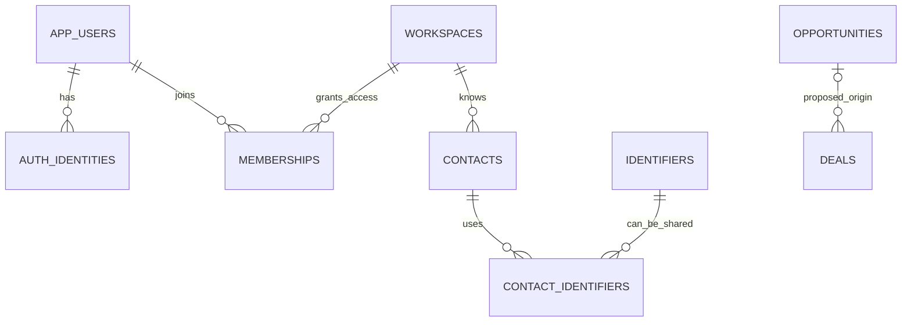

# Foundation and CRM schema design

Status: draft for discussion, October 5, 2026. This is the proposed relational model for the foundation and first CRM release. It preserves the accepted architecture and identifies choices that are still proposals. The October 12 identity slice implements users, identity mappings, workspaces, memberships, roles/permissions, a bootstrap audit event, and the durable installation latch. See [implementation scope](identity-slice.md). Remaining tables and choices below are still proposed; invitations, module selection, Contacts, and CRM migrations have not shipped.

The main separation is **login identity → application user → workspace membership**, alongside **contacts → opportunities → optional deals**. Contacts are people known to a business; memberships grant staff access. Neither a matching email nor a contact-to-user link grants membership.

The [CRM plan](crm-plan.md) owns product behavior, the [architecture](architecture.md) owns module and authorization rules, and this document owns the proposed tables, relationships, and constraints. Choices here remain proposed unless explicitly recorded as accepted in those plans.

## Core relationships



The origin cardinality is proposed. Explicit contact-to-user links are deferred until their proof/cardinality rules are selected; the diagram deliberately has no automatic contact-to-login edge.

## Schema ownership

| PostgreSQL schema | Owner and contents |
| --- | --- |
| `auth` | Supabase only: accounts, credentials, sessions, and provider identities. |
| `suite` | Application users, verified identity mappings, workspaces, access, module selection, shared tag catalog, audit, and operation reliability. |
| `contacts` | People, organizations, contact identifiers, their relationships, and contact/organization tag assignments. Always available independently of CRM. |
| `crm` | Opportunities, deals, statuses, participants, activities, and CRM tag assignments. |
| `pgmq` and extension objects | PGMQ implementation; use its supported functions rather than editing queue tables. |

These are ownership namespaces inside the same PostgreSQL database, allowing one SQLx transaction to commit related business records, audit, and queued work. Cross-module foreign keys protect references; they do not authorize cross-module DAO reads or writes. Rust operations invoke the owning module's interface.

## Common rules

- Proposed IDs: PostgreSQL `uuid` with `gen_random_uuid()` defaults. Keep public IDs opaque; use explicit creation timestamps and `(created_at, id)` cursors for ordering. Do not depend on UUID order or introduce a UUID extension merely for this scaffold.
- Workspace-owned entity rows have `id`, `workspace_id NOT NULL`, `created_at timestamptz`, `updated_at timestamptz`, and `version bigint NOT NULL DEFAULT 1 CHECK (version > 0)`. Join rows have the composite key appropriate to their relationship; immutable audit/history rows do not need edit versions.
- Use `UNIQUE (workspace_id, id)` on referenced entities and composite foreign keys for workspace-owned links. An ID-only foreign key does not establish that two rows belong to the same workspace. Global users are the deliberate exception.
- Require optimistic edits: update by workspace, ID, and expected version; increment version atomically and return a conflict for stale input. Set timestamps in the same operation. Do not silently retry a stale user edit.
- Field conventions: `*_at` is `timestamptz`, `*_on` is `date`, `*_id` is UUID except explicitly named catalog keys, and `?` in the tables below means nullable. Strings have operation-specific size limits before migration finalization.
- Core fields use typed columns. Use bounded, schema-versioned JSONB for job payloads, audit details, and idempotency results; do not make every business record a generic JSON document. Custom fields are a separate future design.
- Use text plus checks for small system state vocabularies, editable rows for user-defined statuses, and stable text keys for code-defined permissions. Do not encode user-created statuses in PostgreSQL enums.
- Financial estimates use `numeric(20,6)` plus a validated currency code; value and currency are either both present or both absent. They are estimates/transaction values, not accounting ledgers. Rounding, negative adjustments, and aggregate currency conversion need their owning operations.
- Default to `ON DELETE RESTRICT` for business parents and attribution. Deactivate users/memberships; explicitly archive business records where specified. Hard deletion, erasure, workspace teardown, and retention need separate operations. Cascades are limited to pure assignment rows during an authorized hard-delete operation, never Auth-to-business cascades.
- Index for scoped access, including child-side foreign keys and common `(workspace_id, created_at, id)` lists. Composite foreign keys and partial unique indexes complement Rust authorization; they do not replace it. PostgreSQL does not automatically index referencing foreign-key columns. [PostgreSQL constraints](https://www.postgresql.org/docs/17/ddl-constraints.html)

## Identity and staff access

The following is the first migration group, before Contacts writes become available. `users` and `auth_identities` are installation-wide; `permissions` and `applications` are global catalogs. Workspace-scoped rows use the common workspace fields; those global tables do not.

| Table | Important columns beyond common fields | Constraints and behavior |
| --- | --- | --- |
| `suite.users` | `id`, `display_name`, `state` (`active`, `suspended`), timestamps/version; no workspace ID | Stable application actor. No password, refresh token, or globally unique business email here. |
| `suite.auth_identities` | `id`, `user_id`, `issuer`, `subject`, `linked_at`, `disabled_at?` | Unique `(issuer, subject)`; FK to application user. An issuer/subject can never identify two application users. |
| `suite.workspaces` | `id`, `name`, `state` (`active`, `suspended`), timestamps/version | A business access boundary, not an organization/contact record. |
| `suite.memberships` | `workspace_id`, `user_id`, `state` (`active`, `suspended`, `removed`), `joined_at` | Unique `(workspace_id, user_id)` for a durable relationship. Reinstatement is an audited change to that relationship; historical references remain valid. |
| `suite.permissions` | `key` text PK, `application_key?`, description | Code/migration-defined catalog. Suggested actions: `contacts.read`, `contacts.create`, `contacts.update`, `contacts.export`, `crm.opportunities.read`, `crm.deals.update`, `workspace.members.manage`. |
| `suite.roles` | `workspace_id`, `key`, `name`, `archived_at?` | Unique `(workspace_id, key)`. Role IDs/keys are stable; names are editable. Initial presets remain undecided. |
| `suite.role_permissions` | `workspace_id`, `role_id`, `permission_key` | Unique assignment; scoped role FK and permission-catalog FK. No arbitrary permission strings. |
| `suite.membership_roles` | `workspace_id`, `membership_id`, `role_id` | Composite PK; both FKs include workspace. Multiple roles combine permitted actions; no implicit deny-rule language initially. |
| `suite.applications` | `key` text PK, name | Code/migration-defined list of optional applications; not a dynamic plugin loader. |
| `suite.workspace_applications` | `workspace_id`, `application_key`, `enabled`, timestamps/version | PK `(workspace_id, application_key)`. Missing row means disabled. Foundation/Contacts are not selectable applications. |

The `issuer` and `subject` are verified credential values, not form fields. `subject` is text to avoid depending on a provider's ID representation; application user IDs stay UUIDs. An application user can have multiple explicitly linked mappings, but an installation accepts only its configured issuer. A hosted cutover may add a reviewed mapping; it does not make the old issuer trusted or automatically link equal emails.

Do not add a mandatory FK from this mapping to `auth.users`: hosted and local Auth are independent, and stable business attribution must survive provider migration or account removal. This deliberate application-owned reference requires login verification and account-state reconciliation; an existing mapping alone never proves a valid login. Suspending an application user blocks suite access even with a valid upstream session.

Authorization checks the current user, membership, active roles, role permissions, module state, and resource policy inside each business operation. Removing a membership also removes its current role assignments atomically; audit retains their history. Reinstatement grants only newly approved roles, never dormant administrative privileges. Suggested initial **workspace-wide visibility** is still awaiting the user's choice. Ownership columns below track responsibility; ownership does not automatically grant or restrict access. If assigned/team visibility is selected, design its rule and tables before shipping reads, exports, matching results, or tags/counts.

Do not hard-code access based on role labels. The last active administrative membership must be protected by an operation that locks the workspace and evaluates effective management permissions. Final bootstrap/recovery and admin-preservation rules need agreement before grants are seeded.

### Staff invitations and bootstrap

| Table | Important columns | Constraints and behavior |
| --- | --- | --- |
| `suite.member_invitations` | `workspace_id`, `recipient_email`, `token_digest`, `expires_at`, `state` (`pending`, `accepted`, `revoked`), `invited_by_membership_id`, `accepted_by_user_id?`, `accepted_at?`, `revoked_at?` | Unique token digest; workspace-qualified inviter FK; state/timestamp consistency checks. Expiration is evaluated against time, not a background job that must have already changed the state. |
| `suite.invitation_roles` | `workspace_id`, `invitation_id`, `role_id` | Scoped FKs to invitation and role; grants are stored server-side and reviewed again on acceptance. |

Store only a digest of a high-entropy invitation token in the invitation row. Never log it or place it in idempotency/audit response bodies. If durable email delivery must retain a usable link, keep its secret material encrypted in a separately controlled delivery mechanism with expiry; digest-only storage cannot reconstruct a token. The delivery mechanism belongs to the authentication implementation, not a speculative CRM communications schema.

Acceptance verifies identity and intended recipient, locks invitation/workspace access state, checks expiration/revocation and current grant policy, then atomically accepts once, creates/reactivates the approved membership, assigns roles, and audits. For an already active membership, current roles are not implicitly replaced; adding roles still requires current grant authority. A removed membership has no active assignments to restore. Role-definition changes must not silently increase a pending invitation's approved authority: the first implementation must either invalidate/reissue affected invitations or pin and revalidate their granted permissions.

Bootstrap has a separate installation-level, one-time authorization path; do not use public signup or an ordinary workspace invitation as the first-admin escape hatch. Its installation lock/state and recovery proof must be specified with the login flow before enabling it. It must not reopen just because the last member was removed.

## Contacts and organizations

| Table | Important columns beyond common fields | Constraints and behavior |
| --- | --- | --- |
| `contacts.contacts` | `display_name`, optional `given_name`/`family_name`, `owner_membership_id?`, `archived_at?` | No globally unique name/email/phone. Display name need not imply Western first/last-name structure. Owner FK includes workspace. |
| `contacts.organizations` | `name`, `website_url?`, `owner_membership_id?`, `archived_at?` | Neither company name nor domain is a unique identity. |
| `contacts.contact_organizations` | `workspace_id`, `contact_id`, `organization_id`, `relationship_label?`, `job_title?`, `is_primary`, timestamps | Unique `(workspace_id, contact_id, organization_id)` for the initial current relationship; scoped FKs. At most one primary organization per contact via a partial unique index. Relationship history/multiple simultaneous roles require a later extension. |
| `contacts.identifiers` | `workspace_id`, `kind` (`email`, `phone`), `normalized_value`, `normalization_version`, `created_at` | Unique `(workspace_id, kind, normalized_value)`. This identifies an address/number, not a person. Preserve original input on the association. |
| `contacts.contact_identifiers` | `id`, `workspace_id`, `contact_id`, `identifier_id`, `kind`, `original_value`, `label?`, `phone_extension?`, `is_primary`, `source`, `verified_at?`, `verification_method?`, `created_at`, `ended_at?` | Scoped FKs; identifier FK includes `kind` to prevent a mismatched copied discriminator. Unique active contact/identifier association; at most one active primary identifier of each kind per contact. |

`contact_identifiers.kind` is deliberately duplicated to support an enforceable per-kind primary constraint; use `UNIQUE (workspace_id, id, kind)` on the identifier target. Verification belongs to the association and records precisely what was verified. It never confers login access or proves that someone sharing a mailbox is a specific contact.

For Alex and Sam sharing `office@example.com`, create **one identifier row and two contact-association rows**. Auth remains independent. Ending an association retains history; a new association can record a recycled address without silently moving someone's identity. Primary identifiers are optional; “at most one” does not force a contact to have an address.

Proposed normalization is conservative: trim email whitespace, canonicalize/lowercase the domain, preserve local-part case, and preserve dots/plus tags. Case-only local-part matches can be review suggestions but are not automatic merges. SMTP formally permits case-sensitive local parts, so case folding is a product trade-off rather than a universally correct identity rule. [RFC 5321 section 2.3.11](https://www.rfc-editor.org/rfc/rfc5321.html#section-2.3.11)

For phones, parse using explicit country context and store E.164 in the identifier. Extensions belong on associations; a shared switchboard number with different extensions remains potentially ambiguous. Invalid values do not enter the matching registry. A versioned normalization change needs a collision review/migration, not a silent rewrite of keys.

Matching operates on active associations and accounts for archived contacts. An archived match requires an explicit restore/review decision, not silent reactivation or creation of another person. Coordinate all affected identifier keys in deterministic order before match/create/link changes, including previously unseen values (for example, transaction advisory locks plus unique constraints). A unique registry row by itself does not prevent two contacts being created concurrently. Shared identifiers are allowed, so a uniqueness constraint on identifier-to-contact cannot solve this.

Automatic intake may reuse an unambiguous authorized match. An explicit permitted create/link operation can record a separate person sharing an identifier after review. Conflicting email/phone matches never auto-merge or overwrite trusted fields. Matching must not disclose hidden candidate contacts if restrictive visibility is chosen; route such intake to an authorized review operation with a non-disclosing response.

### Contacts who later sign in

Reserve a future `contacts.contact_user_links` relation for an explicitly verified association between `workspace_id`, `contact_id`, and application `user_id`. Do not create it automatically from identifiers, and do not grant a staff membership as a side effect.

Proposed starting cardinality for a **self-identity** link: at most one active user per contact and one active contact per user within a workspace. A user can still represent different contact records in different workspaces. This remains a product choice, not a migration constraint yet. Guardian/assistant/shared-account representation would use separate scoped grants, not relax the meaning of a self-identity link. Contact onboarding invitations and portal grants wait for that access design; keep them separate from member invitations.

## Opportunities and deals

Opportunities represent potential business. Deals represent concrete transactions or engagements. Both own their own IDs, versions, participants, tags, and history; neither is a filtered view of the other.

| Table | Important columns beyond common fields | Constraints and behavior |
| --- | --- | --- |
| `crm.opportunity_pipelines` | `workspace_id`, `name`, `archived_at?` | Begin with one default pipeline per workspace; table shape permits additional pipelines without forcing their UI in the first slice. |
| `crm.opportunity_stages` | `workspace_id`, `pipeline_id`, stable `key`, editable `name`, `position`, `outcome` (`open`, `won`, `lost`), `archived_at?` | Unique `(workspace_id, pipeline_id, key)`; scoped pipeline FK. Use `(position, id)` ordering so reorder transactions need not maintain globally unique positions. |
| `crm.opportunities` | `workspace_id`, `title`, `pipeline_id`, `stage_id`, `owner_membership_id?`, `expected_value?`, `currency_code?`, `expected_close_on?`, `closed_at?`, `archived_at?` | Stage FK includes workspace and pipeline. A stage from another pipeline/workspace is invalid. Value/currency paired; owner is a scoped membership. |
| `crm.deal_statuses` | `workspace_id`, stable `key`, editable `name`, `position`, `category` (`active`, `completed`, `cancelled` proposed), `archived_at?` | Unique `(workspace_id, key)`; independent from opportunity stages. A separate deal-pipeline abstraction waits for a real requirement. |
| `crm.deals` | `workspace_id`, `title`, `status_id`, `originating_opportunity_id?`, `owner_membership_id?`, `value?`, `currency_code?`, `starts_on?`, `ends_on?`, `archived_at?` | Scoped status/origin/owner FKs; end date not before start when both exist. Direct creation is valid. |
| `crm.opportunity_contacts`, `crm.deal_contacts` | `workspace_id`, parent ID, `contact_id`, `role_label?`, `is_primary` | Separate assignment tables with scoped FKs and unique parent/contact pairs. At most one primary contact per parent. |
| `crm.opportunity_organizations`, `crm.deal_organizations` | `workspace_id`, parent ID, `organization_id`, `role_label?`, `is_primary` | Separate assignment tables with scoped FKs, unique parent/organization pairs, and at most one primary organization per parent; support more than one organization without a generic “party” supertable. |
| `crm.opportunity_stage_changes` | `workspace_id`, `opportunity_id`, `from_stage_id?`, `to_stage_id`, outcome/label snapshots, `changed_at`, `audit_event_id`, `operation_id` | Immutable transition history; initial assignment can have no previous stage. Scoped parent, stage, and audit-event references; actor attribution comes from the immutable audit event. |
| `crm.deal_status_changes` | `workspace_id`, `deal_id`, `from_status_id?`, `to_status_id`, category/label snapshots, `changed_at`, `audit_event_id`, `operation_id` | Separate immutable deal history. Scoped audit-event FK supplies user/system execution attribution without a human-only actor column. |

**Origin cardinality pending:** recommended zero-or-one originating opportunity per deal; zero-or-many deals per opportunity. Do not make `originating_opportunity_id` unique. If deals can consolidate multiple opportunities, replace this column with a scoped `crm.opportunity_deals` join before implementing that migration.

Winning an opportunity does not automatically create or complete a deal. An explicit “create deal from opportunity” operation can copy selected data and change the opportunity outcome when requested, atomically and idempotently. Exact conversion behavior belongs in the product operation, not an implicit insert trigger.

Renaming a stage/status does not change any record's state. Proposed semantic category/outcome mappings are immutable once used; changing meaning creates a new definition and uses explicit transitions. This avoids rewriting history merely by relabeling a stage. Archive referenced definitions instead of deleting them; no new assignment to an archived definition. Transition operations validate categories and maintain `closed_at`; an ordinary row `CHECK` cannot validate another table's outcome. Pipeline moves explicitly map the destination stage and record the transition.

Historical labels/outcomes are snapshots in history; current screens use the current definition's label. Opportunity/deal ownership, participant links, and status transitions all use the same workspace-qualified references. No separate lead table is proposed initially; qualification can use opportunity stages until a distinct lead workflow is justified.

## Tags and activities

| Table | Important columns | Constraints and behavior |
| --- | --- | --- |
| `suite.tags` | `workspace_id`, `name`, `name_key`, `color?`, `archived_at?`, common entity fields | Unique `(workspace_id, name_key)`. Proposed key is trimmed, consistently case-folded text. Do not reuse archived names without a deliberate restore/rename decision. |
| `contacts.contact_tags`, `contacts.organization_tags` | `workspace_id`, record ID, `tag_id`, `created_at`, attribution | Scoped record/tag FKs; composite PK prevents duplicate assignments. Contacts owns these writes. |
| `crm.opportunity_tags`, `crm.deal_tags` | `workspace_id`, record ID, `tag_id`, `created_at`, attribution | Same constraint pattern; CRM owns these writes and checks module state. |
| `crm.activities` | `workspace_id`, `kind` (`note`, `task`, `call`, `meeting` proposed), `subject`, `body?`, `due_at?`, `completed_at?`, `owner_membership_id?`, `contact_id?`, `opportunity_id?`, `deal_id?`, common entity fields | Proposed first shape requires exactly one anchor, using a same-row check and scoped FKs. Activity visibility must respect its anchor. Scheduling/communications are not implicitly implemented by recording a call/meeting activity. |

The tag catalog is shared; assignments remain typed and module-owned. Avoid a generic `(entity_type, entity_id, tag_id)` table whose target cannot have an ordinary foreign key. Counts and search results operate only over authorized, enabled records; they cannot be an access bypass.

Activity shape is a later CRM migration, after confirming follow-up behavior and visibility. A contact-anchored CRM activity remains CRM-owned and is unavailable with CRM disabled; a future standalone Contacts notes feature would need its own operation/model. More than one activity anchor, attachments, external calendars, and omnichannel messages are separate later requirements, not hidden JSON flags in this draft.

## Audit and retry reliability

| Table | Important columns | Invariants |
| --- | --- | --- |
| `suite.audit_events` | `id`, `workspace_id`, `occurred_at`, `operation_id`, `request_id`, `actor_kind` (`user`, `system`), `actor_user_id?`, `action`, `record_kind`, `record_id?`, bounded `details` JSONB | User actors require an application user FK. System events require explicit server-established execution attribution, never an untrusted caller flag. Insert with the material business mutation. No runtime UPDATE/DELETE grants. |
| `suite.idempotency_records` | `workspace_id`, `actor_user_id`, stable `operation_key`, `idempotency_key`, `request_hash`, `operation_id`, bounded `result` JSONB, `created_at`, `expires_at` | Unique `(workspace_id, actor_user_id, operation_key, idempotency_key)` for current first-party calls. Store with the write; a rollback leaves no successful result. |
| `suite.jobs` | `id`, `workspace_id`, `application_key?`, `kind`, `payload_version`, bounded `payload` JSONB, `originating_operation_id`, `state`, attempts/limit, next eligibility, completion/failure metadata | Add with the first real follow-up operation. Job progress is application-owned; PGMQ supplies durable dispatch and leases, not business authority. |

Audit target kind/ID and details are historical evidence, not live resource links or permission grants. Unlike tags/participants, those references intentionally need to outlive a business record; reads still require audit permissions. Keep tokens, raw credentials, and unnecessary customer payloads out of audit. ClickHouse is an optional projection/diagnostic sink, never the authoritative commit record.

Idempotency is independent of contact matching and optimistic edits. Claim a key in the business transaction; concurrent same-key requests coordinate through the unique constraint. Equal inputs can replay the committed result after current authorization checks; different payload hashes return a conflict. The result must not contain reusable secrets. Decide canonical hashing, response scope, retention, and behavior after expiry before advertising guarantees. Later delegated calls must additionally bind retries to their verified client/grant so one integration cannot retrieve another's results.

Queue envelopes can contain just a stable job ID. Create job metadata and call `pgmq.send` in the same transaction as the business/audit change. Define application claim/attempt/lease fencing and reconcile progress with redelivery when implementing the worker; a stored `running` flag cannot substitute for those controls. Exhausted/blocked jobs remain visible, and disabled modules require explicit resume policy. Do not build another broker, a generic event-store architecture, or a full workflow-step schema for the first Contacts operation.

## Example database constraint

This illustrates the workspace pattern only; it is not an applied migration:

```sql
CREATE TABLE contacts.contacts (
    id uuid PRIMARY KEY DEFAULT gen_random_uuid(),
    workspace_id uuid NOT NULL REFERENCES suite.workspaces(id),
    display_name text NOT NULL CHECK (length(btrim(display_name)) > 0),
    UNIQUE (workspace_id, id)
);

CREATE TABLE contacts.contact_tags (
    workspace_id uuid NOT NULL,
    contact_id uuid NOT NULL,
    tag_id uuid NOT NULL,
    PRIMARY KEY (workspace_id, contact_id, tag_id),
    FOREIGN KEY (workspace_id, contact_id)
        REFERENCES contacts.contacts(workspace_id, id),
    FOREIGN KEY (workspace_id, tag_id)
        REFERENCES suite.tags(workspace_id, id)
);
```

A tag from workspace B cannot be attached to a contact in workspace A, even if application code accidentally supplies both valid UUIDs. This protects stored relationships; Rust still must prevent reads from the wrong workspace.

## Migration sequence and decision gates

| Sequence | Deliverable | Decisions or evidence required first |
| --- | --- | --- |
| 1 | Users, verified identity mappings, workspaces, memberships, permission/role catalog and assignments, module selection, staff invitations | Role presets, visibility, bootstrap/recipient proof, prevention of unauthorized grants. No unprotected bootstrap endpoint. |
| 2 | Audit/idempotency support and Contacts/organizations/identifiers/relationships/tag catalog plus contact assignments | Approve normalization, matching/archiving behavior, identifier sharing, retry retention, and visibility treatment. Test via one authorized create/list journey. |
| 3 | Job metadata and the first actual queued follow-up | SQLx business/audit/PGMQ transaction, bounded retries, lease expiry/redelivery, module state and execution authority. |
| 4 | Opportunity/deal pipelines/statuses, records, participants, transitions, tags | Origin cardinality, stage/category semantics, supported participant roles, conversion behavior, and ownership/visibility. |
| 5 | CRM activities; explicit contact-to-login invitations/links and customer grants when scheduled | Activity workflow and portal/self-identity versus representation rules. A portal link must not imply staff access. |

All suite SQL remains in `supabase/migrations/`, with one Supabase CLI history. Each group should ship only when its owning operation and denial/constraint tests are ready; this document is not an instruction to generate every table immediately.

Required negative tests include cross-workspace assignments, wrong-pipeline stages, duplicate membership/role/tag assignments, revoked membership with a valid session, conflicting/shared identifier matches, concurrent intake, invitation replay, stale record versions, mismatched idempotency payloads, disabled CRM access, and rollback of business/audit/queue writes. Also test that a contact merge or email change cannot alter an Auth identity or grant access.

Open product choices: staff roles/visibility; opportunity/deal origin cardinality; email local-part policy; self-identity link cardinality; exact deal categories; contact merge/retention and activity scope. The suggested defaults above make those choices concrete without silently treating them as accepted.
